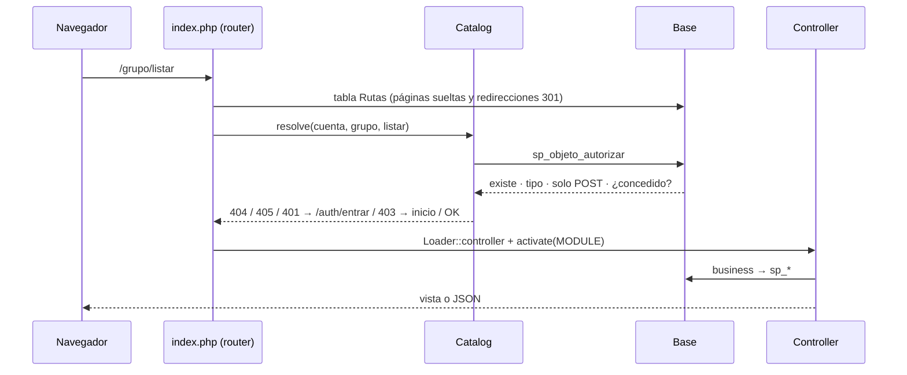

# 01 · Arquitectura

## Carpetas (`master`)

| Carpeta | Qué hay |
|---|---|
| `apiService/core/` | El framework de NeuralStack Code: `Controller`, `Entity`, `Command`, `Catalog`, `Loader`, `Crypto`… No se edita a mano: se actualiza desde la api |
| `apiService/tools/catalogo/` | `generar_semilla.php`: arma la semilla del catálogo leyendo los controllers |
| `webService/controllers/` | Un controller por componente (`/alumno/...` → `AlumnoController`). Es el backend: valida, decide y responde |
| `webService/business/<módulo>/` | Solo datos: llama a los procedures |
| `webService/models/<módulo>/` | Las variables de cada entidad |
| `webService/libs/` | Lo que comparten varios módulos (`TipoCuenta`, `GrupoOpcion`, `PersonaOpcion`, `CatalogoCodigo`, cifrado). No va en `wwwroot`: es PHP privado |
| `webService/views/` | Las pantallas |
| `webService/wwwroot/` | Lo único público: CSS, JavaScript e imágenes |

Módulos: `escolar`, `pagos`, `padre`, `sistema`, y `framework`, que siempre está activo.

## Cómo viaja una petición

- No hay rutas escritas en el código: si un método no está en el catálogo, responde 404.
- Las URLs viejas (`/administrador/...`, `/inicio-sesion`…) redirigen con 301 desde la tabla `Rutas`.
- Auditoría: `IdUsuarioRegistra`/`IdUsuarioCambia` guardan la **cuenta** que actuó (`Command::actor`).
